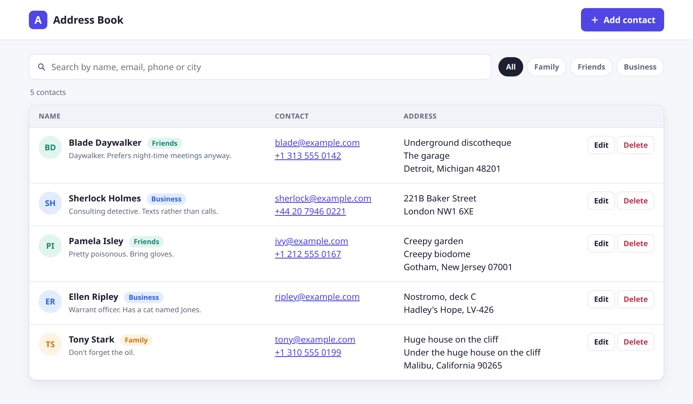
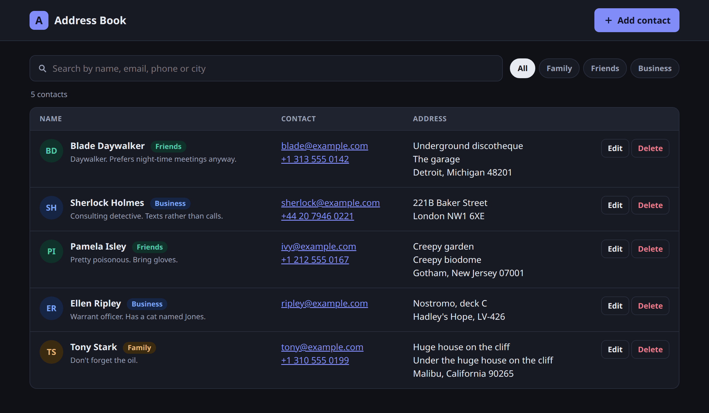
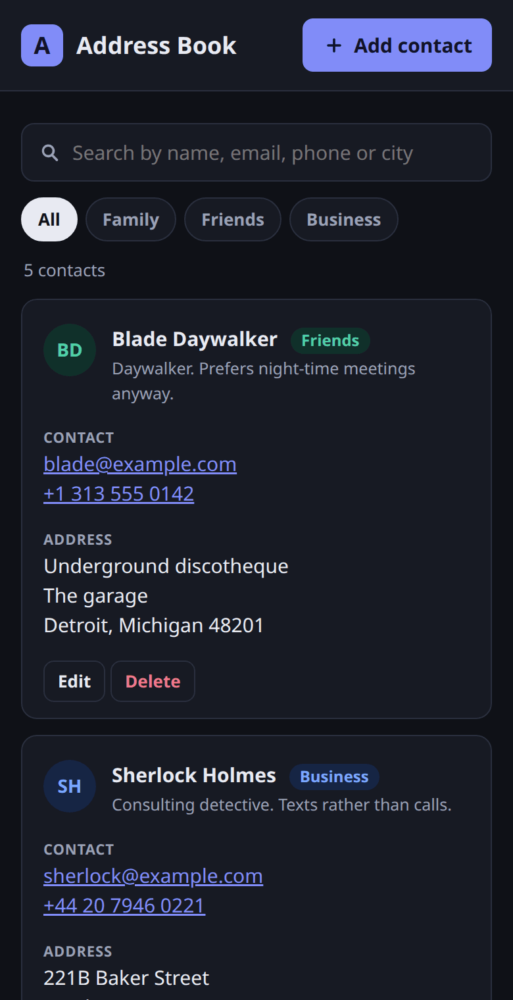

# Address Book

[](https://github.com/alextenche/addressBook/actions/workflows/ci.yml)


A small, complete contacts manager: search, filter by group, and add, edit or delete contacts in a modal, with no page reloads. It's built with **Slim 4**, **Twig**, **MariaDB** and plain modern JavaScript and CSS. There's no front-end framework and no build step.



<table>
  <tr>
    <td width="62%"></td>
    <td></td>
  </tr>
</table>

## Features

- **Contacts CRUD** in a native `<dialog>`, using `fetch()` and server-side validation errors shown inline under each field.
- **Live search** across name, email, phone and city, plus **group filters** (family / friends / business). The URL keeps the filter, so it can be shared or bookmarked.
- **Works without JavaScript.** Every action is a real HTML form with a server-rendered fallback page, and JS only enhances it.
- **Responsive**: the table turns into cards on phones. Light and dark themes follow the OS setting.
- **Secure by construction**:
  - Twig auto-escaping blocks XSS.
  - Per-session CSRF tokens protect every write.
  - All SQL uses server-side prepared statements, with `LIKE` wildcards escaped.
  - A strict Content-Security-Policy is set.
  - Session cookies are `HttpOnly` and `SameSite`.
  - Error details are hidden outside debug mode.

## Quick start

All you need is Docker.

```bash
git clone https://github.com/alextenche/addressBook.git
cd addressBook
docker compose up
```

Open <http://localhost:8080>. On first start, the database is migrated and seeded with a few demo contacts.

## Development

```bash
docker compose exec app composer test   # Pest: unit + feature tests (uses a separate addressbook_test DB)
docker compose exec app composer stan   # PHPStan, level 8
docker compose exec app composer lint   # PHP-CS-Fixer (PER-CS 2.0), dry run
docker compose exec app composer fix    # ...and apply fixes
docker compose exec app php bin/migrate --fresh --seed   # reset the database
```

To run without Docker, you need PHP 8.3+ with `pdo_mysql` and a MySQL 8 or MariaDB 10.6+ server. Copy `.env.example` to `.env`, then run `composer install`, `php bin/migrate --seed` and `php -S localhost:8080 -t public`.

### HTTP API

The same routes serve HTML or JSON, depending on the `Accept` header. Writes need the CSRF token from the page's `<meta name="csrf-token">`, sent as an `X-CSRF-Token` header.

| Method | Path | Purpose |
|---|---|---|
| `GET` | `/contacts?q=&group=` | List or search contacts |
| `POST` | `/contacts` | Create a contact (`201`, or `422` with field errors) |
| `GET` | `/contacts/{id}` | Show one contact |
| `PUT` | `/contacts/{id}` | Update a contact |
| `DELETE` | `/contacts/{id}` | Delete a contact (`204`) |

## How it's built

```
public/index.php           front controller; public/ is the only web-served directory
bootstrap/app.php          builds the Slim app (PHP-DI container, middleware, routes)
config/                    container definitions, middleware stack, routes
src/Domain/                Contact (readonly), ContactInput, ContactGroup (backed enum)
src/Repository/            ContactRepository: PDO with prepared statements
src/Validation/            ContactValidator: trims, normalises and validates untrusted input
src/Http/                  controller, CSRF guard and middleware, session abstraction
templates/                 Twig layout, list, and one form partial shared by the dialog and the no-JS page
database/                  SQL migrations (run by bin/migrate) and seed data
public/assets/             app.js (vanilla ES module) and app.css (custom properties, grid, dark mode)
tests/                     Pest: Unit (validator, domain, CSRF) and Feature (HTTP → real database)
docker/, compose.yaml      PHP 8.4 + Apache and MariaDB 11.4; dev and production image targets
```

GitHub Actions runs PHP-CS-Fixer, PHPStan and the full test suite against MariaDB on PHP 8.3, 8.4 and 8.5, and checks that the production image builds.

## History

This started in December 2014 as one of my first PHP projects, built while following a course. It used PHP 5.5, `mysql`/PDO, Foundation 5 and jQuery. In 2026 I rewrote it from scratch to show how I'd build the same app today. The original code is preserved at the [`v0-2014-tutorial`](https://github.com/alextenche/addressBook/tree/v0-2014-tutorial) tag.

## License

[MIT](LICENSE)
